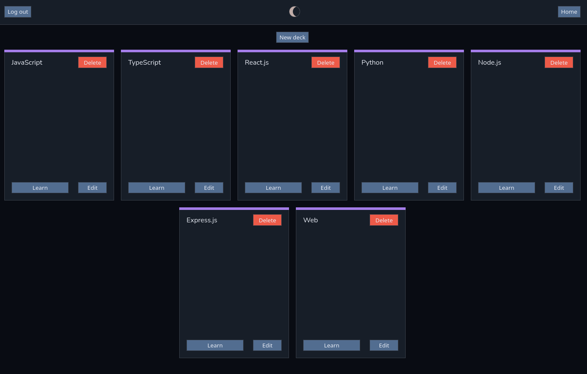

# [Flashcards](https://vasya-556.github.io/flashcards/)

This is my app for learning different materials using flashcards



# Table of contents

- [Flashcards](#flashcards)
- [Table of contents](#table-of-contents)
- [Usage](#usage)
- [Installation](#installation)
  - [Docker](#docker)
- [Contributing](#contributing)
- [License](#license)

# Usage

1. Login
2. Create deck
3. For that deck create cards
4. Press learn on home page 

# Installation

1. Clone the repository
```bash
git clone https://github.com/Vasya-556/flashcards.git
cd flashcards
```

2. Install backend dependencies
```bash
cd backend
npm install
```

3. Install frontend dependencies
```bash
cd ../frontend
npm install
```

4. Configure env files
```bash
# backend
cd ../backend
cp .env.example .env
# set variables in .env

# frontend
cd ../frontend
cp .env.example .env
# set variables in .env
```

5. Fill in those variables and secrets in .env

6. Start the app
```bash
# backend
cd ../backend
npm run dev
# frontend
cd ../frontend
npm run dev
```

7. [Visit](http://localhost:5173/flashcards)

## Docker

Alternatively you can setup the app with docker

1. Clone the repository
```bash
git clone https://github.com/Vasya-556/flashcards.git
cd flashcards
```

2. Configure env files
```bash
# backend
cd ../backend
cp .env.example .env
# set variables in .env

# frontend
cd ../frontend
cp .env.example .env
# set variables in .env
```

3. Fill in those variables and secrets in .env

4. Build docker
```bash
docker compose up --build
```

5. Run
```bash
docker compose up
```

6. [Visit](http://localhost:5173/flashcards)

7. Stop docker
```bash
docker compose down
```

# Contributing

Please do!

# License

[GNU General Public License v3.0](LICENSE)